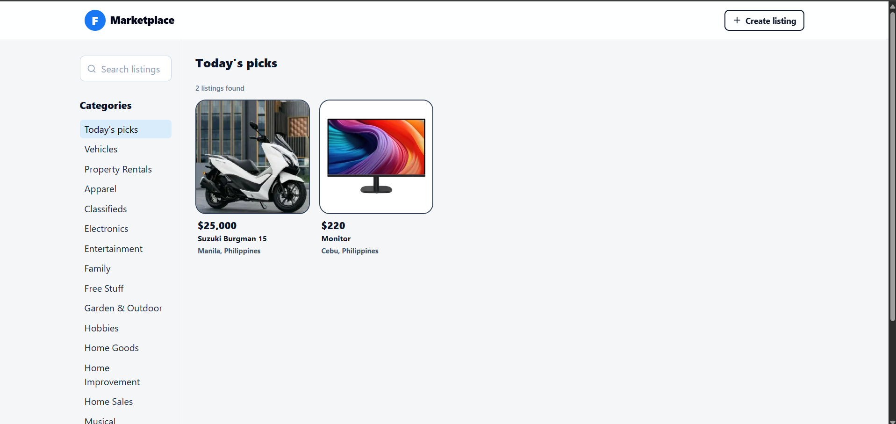
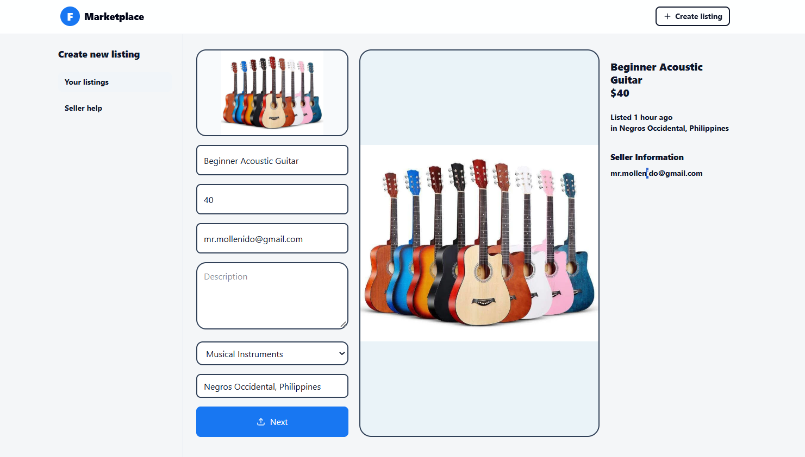
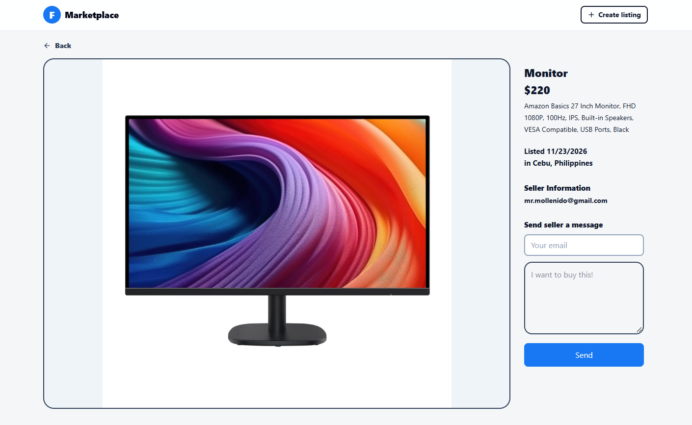

# Marketplace

A responsive marketplace built with Next.js 15, React 19, Tailwind CSS 4, and Supabase.

## Live demo

[https://marketplace-seven-mu-43.vercel.app/](https://marketplace-seven-mu-43.vercel.app/)

## Screenshots

### Browse listings



### Create a listing



### Listing details and seller messaging



## Local setup

1. Create a Supabase project.
2. Run `supabase-schema.sql` in the Supabase SQL editor. If the project already has the marketplace tables, run it again to add the `messages.submission_id` column and its unique index.
3. Copy `.env.example` to `.env.local` and set:
   - `NEXT_PUBLIC_SUPABASE_URL`
   - `NEXT_PUBLIC_SUPABASE_PUBLISHABLE_KEY` (or legacy `NEXT_PUBLIC_SUPABASE_ANON_KEY`)
   - `RESEND_API_KEY`
   - `RESEND_FROM_EMAIL`
4. Install dependencies and start the app:

```bash
npm install
npm run dev
```

Open `http://localhost:3000`. Restart the dev server after changing environment variables.

## Resend email notifications

1. The Resend SDK is included in this project. To install it separately in a fresh checkout, run `npm install resend`.
2. Create a Resend account and an API key with permission to send email.
3. Verify a domain in Resend. The address configured in `RESEND_FROM_EMAIL` must use that verified domain (for example, `Marketplace <marketplace@mail.yourdomain.com>`).
4. Put the key and verified sender address in local `.env.local`. Keep `RESEND_API_KEY` server-only: never add a `NEXT_PUBLIC_` prefix, commit `.env.local`, or expose the key in client code.
5. In Vercel, add `RESEND_API_KEY` and `RESEND_FROM_EMAIL` to the project’s Environment Variables for the environments you use, then redeploy.

The message API first saves the buyer’s message in Supabase, then sends a notification to the seller email stored on that listing. Email failures do not undo a saved message. The email uses the buyer’s email as reply-to. If Resend is not configured, message saving still works and the buyer sees that notification was unavailable.

## Supabase

The schema creates the `listings` and `messages` tables, indexes, SQL grants, RLS policies, and the public `listing-images` Storage bucket. It also adds a unique submission ID to prevent duplicate message inserts on request retries. Browser visitors can read and create listings and insert messages, but no message read policy is granted.

## Stripe Connect test setup

The Connect integration creates Accounts v2 sellers with Stripe-hosted onboarding. The current platform configuration uses Stripe-managed fees and losses with the full Stripe Dashboard; Stripe does not support that responsibility configuration with an Express Dashboard.

Connected accounts are currently created with the US country, matching the marketplace’s Palo Alto default location. Stripe-hosted onboarding collects the seller’s remaining business and identity details.

Set `STRIPE_SECRET_KEY`, `STRIPE_WEBHOOK_SECRET`, `STRIPE_V2_WEBHOOK_SECRET`, `SUPABASE_SERVICE_ROLE_KEY`, and `NEXT_PUBLIC_APP_URL` in `.env.local` for local work and in Vercel for production. Keep the Stripe secret, both webhook secrets, and Supabase service-role key server-only. Use test-mode Stripe keys.

Configure two Stripe webhook destinations to the public app URL:

- Snapshot event destination to `/api/stripe/webhook` with **Events from: Connected accounts** for `checkout.session.completed`. Direct charges exist on the connected seller account, so a platform-only endpoint will not receive these events. Store this destination's signing secret in `STRIPE_WEBHOOK_SECRET`.
- Thin event destination to `/api/stripe/webhook/v2` with **Events from: Your account** for `v2.core.account.updated`, `v2.core.account[configuration.merchant].updated`, and `v2.core.account[configuration.merchant].capability_status_updated`. Store this destination's signing secret in `STRIPE_V2_WEBHOOK_SECRET`.

Do not use a Vercel preview URL as the production webhook destination. Configure `NEXT_PUBLIC_APP_URL` to the corresponding public app origin and redeploy after environment changes.

## Testing

- **Keyword search:** enter a listing title or a word from its description. Search ignores case and surrounding spaces, debounces requests, works with the selected category, and can be cleared with the X button.
- **Message/email:** open a listing, submit a valid buyer email and message, then confirm the success status. With Resend configured, check the listing seller’s inbox (and spam folder); verify the email details and reply-to address. Without Resend configured or if delivery fails, the saved-message confirmation explains that the notification could not be delivered.
- Verify invalid email and blank message are rejected, and double-clicking Send does not create duplicate message rows.

## Production

Live app: [https://marketplace-seven-mu-43.vercel.app/](https://marketplace-seven-mu-43.vercel.app/).

Set Supabase and Resend environment variables in Vercel, then redeploy after changing them. Never use or expose a Supabase secret/service-role key or Resend API key in browser code.
